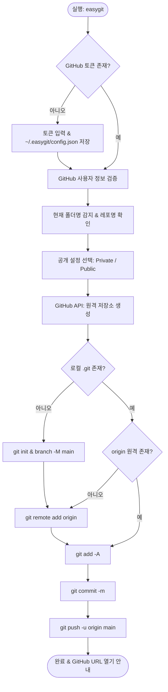

# EasyGit 마스터 정의서 (Master Specification)

## 1. 프로젝트 개요 (Overview)
- **프로젝트명**: EasyGit
- **목적**: 신규 프로젝트 폴더에서 GitHub 원격 저장소 생성, 공개 범위(Private/Public) 설정, 로컬 Git 초기화(`git init`), 최초 커밋(`commit`), 원격 푸시(`push`)까지의 반복적인 초기화 작업을 자동화하는 원클릭/CLI 도구
- **주요 타겟**: 새 프로젝트 시작 시 매번 브라우저에서 GitHub 레포를 만들고 git 명령어를 일일이 입력하기 번거로운 개발자

---

## 2. 핵심 기능 요구사항 (Core Requirements)

### 2.1 폴더명 기반 저장소명 자동 결정
- 현재 실행 위치(또는 프로그램이 위치한 폴더)의 디렉토리명을 기본 저장소명으로 추천.
- 사용자 확인 및 엔터 입력 시 바로 적용, 필요시 수동 변경 가능.

### 2.2 GitHub 인증 및 토큰 관리
- GitHub REST API (`https://api.github.com`) 연동.
- 인증 방식: GitHub Personal Access Token (Classic: `repo` 권한 또는 Fine-grained: `Administration/Contents: Read and write`).
- 토큰 보관:
  - 환경 변수 `GITHUB_TOKEN` 우선 참조.
  - 없을 경우 사용자 홈 디렉토리(`~/.easygit/config.json`)에 최초 1회 입력받아 안전하게 저장 및 재사용.
  - 토큰 변경/재설정 옵션(`--reset-token`) 지원.
- **실행 시 전역 환경 자동 점검 (Self-Setup)**:
  - 실행 시 시스템 PATH 및 PowerShell 프로필 등록 상태를 자동으로 점검하여, 미등록 상태인 경우 최초 1회 자동 설치를 수행하고 이미 등록되어 있으면 무중단 스킵.

### 2.3 공개 범위 (Visibility) 선택
- `1. Private (비공개, 기본값 권장)`
- `2. Public (공개)`
- 대화형 선택지 제공 (기본값: Private).

### 2.4 로컬 Git 및 원격 연동 자동화
1. **로컬 저장소 확인**:
   - `.git` 폴더 부재 시 `git init` 실행.
   - 기본 브랜치를 `main`으로 정렬 (`git branch -M main`).
2. **원격 저장소 생성**:
   - GitHub API (`POST /user/repos`)를 호출하여 저장소 생성.
3. **원격 저장소(origin) 연결**:
   - `git remote add origin https://github.com/<username>/<repo_name>.git`
   - 인증 토큰이 포함된 credential helper 또는 안전한 URL 설정.
4. **스테이징 & 커밋**:
   - `.gitignore` 자동 기본 템플릿 제안 (필요시 생성).
   - `git add -A` 실행.
   - 커밋 메시지 입력 (기본값: `Initial commit`).
   - `git commit -m "<message>"`.
5. **원격 푸시**:
   - `git push -u origin main` 실행 및 성공 결과 출력.

---

## 3. 프로세스 흐름 (Workflow)



---

## 4. 파일 구조 (File Structure)

```
c:\Project\EasyGit\
├── master.md          # 마스터 정의서 (본 문서)
├── easygit.py         # 핵심 로직 (Python 표준 라이브러리 기반, 추가 의존성 없음)
├── easygit.bat        # Windows 더블클릭 및 전역 실행 래퍼 배치 파일
├── install.bat        # 시스템 PATH 등록 스크립트 (어디서나 easygit 명령어 사용 가능)
└── README.md          # 사용 가이드 및 설명서
```

---

## 5. CLI 및 실행 모드 사양

1. **대화형 모드 (기본)**:
   - 더블클릭 또는 `python easygit.py` / `easygit` 실행 시 단계별 안내.
2. **원스톱 비대화형 옵션**:
   - `easygit --public` : Public으로 즉시 생성.
   - `easygit --private` : Private으로 즉시 생성 (기본).
   - `easygit -m "첫 커밋 메시지"` : 커밋 메시지 지정.
   - `easygit --name <이름>` : 저장소 이름 직접 지정.
   - `easygit --reset-token` : 저장된 토큰 초기화.

---

## 6. 예외 처리 정책
- Git 미설치 시: 친절한 설치 안내 메시지 후 안전 종료.
- 이미 Git 저장소(.git 또는 GitHub 원격)가 존재하는 경우:
  `이미 생성한 깃이 존재하는데 만들거냐? (y/N) [기본값: N]` 확인 프롬프트를 띄우고, 'y'를 제외한 모든 입력(엔터 등) 시 안전하게 작업 중단.
- 커밋할 변경사항이 없는 빈 폴더인 경우: 기본 `README.md` 자동 생성 후 커밋 진행.
- 네트워크 또는 토큰 권한 오류: 상세한 HTTP 상태 코드 및 해결 가이드 제공.

